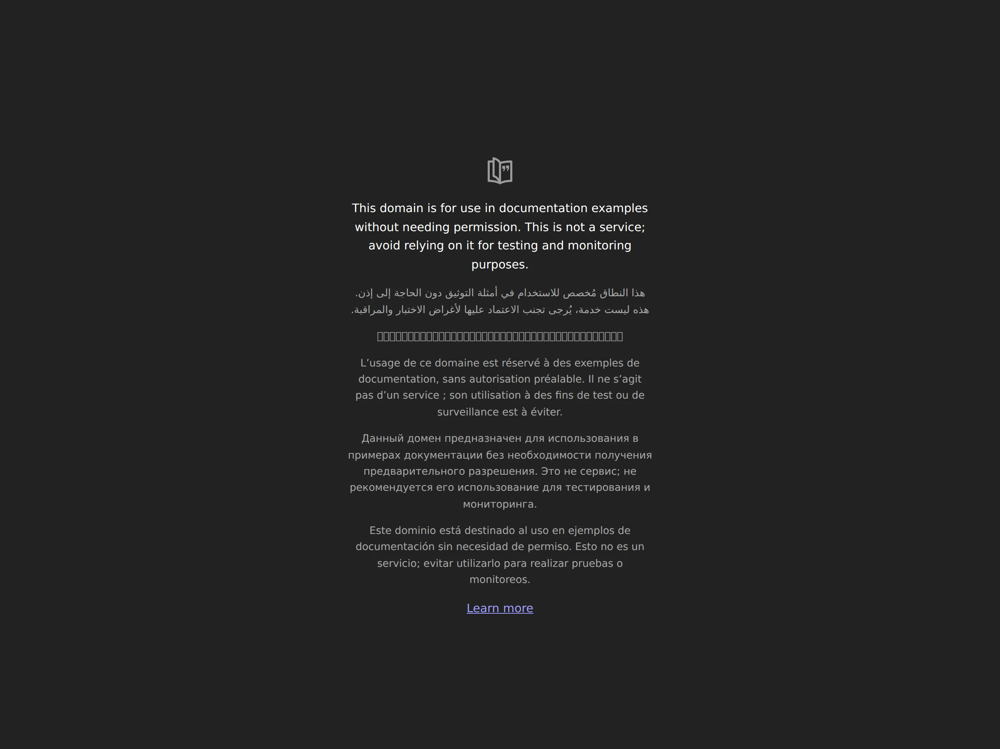

# Astro Notionfolio v2

Notion-inspired personal portfolio built with Astro 7, TypeScript and Tailwind v4. Ships with a fictional owner (John Smith) and Lorem Ipsum content; everything personal is set from one file.



## Make it yours

1. Edit **`site.config.ts`**: name, role, contact, socials, homepage hero/stats/FAQ, about page, skills, SEO data, analytics, newsletter, comments, map location.
2. Replace the content under `src/content/{projects,publications,experience,education,awards,blog}/<slug>/index.md`.
3. Swap images: `src/assets/me.webp` and `public/media/authors/me.webp` (portrait, transparent cutout), `src/assets/albums/projects/<slug>.webp`, `public/media/icons/custom/org-*.svg` (logos), `public/media/seals/<slug>.webp`.
4. Edit `src/data/tech.json` for the tech stack.
5. Regenerate generated assets:

```sh
npm run covers:all                   # blog covers + OG cards (needs Chromium)
npm run build:fast && npm run pdfs   # CV and résumé PDFs
```

Set `PUPPETEER_EXECUTABLE_PATH` if Puppeteer cannot find Chromium.

## Develop

```sh
npm ci --ignore-scripts
npm run dev      # syncs config-derived files, then starts Astro
npm run build    # check + build + search index
npm test
```

Requires Node >=22.18. `npm run sync` writes `robots.txt`, `site.webmanifest`, the redirect pages and the worker's allowed origins from `site.config.ts`.

## Optional integrations

- Analytics: `site.analyticsId` (GA4). Empty disables it.
- Newsletter: `newsletter.url` (Substack). Empty hides the form and nav link.
- Comments: `giscus.repoId` and `categoryId` from giscus.app. Empty disables comments.
- Contact form: `contact.formEndpoint` (Formspree).
- Blog editor (`/blog/write/`): `blogWrite.clientId` and `workerUrl`; deploy `worker/`.
- Publications sync: `zoteroUserId`, then `node scripts/update-pubs.js`.
- Custom domain: set `site.url` and `site.customDomain: true`.

Workflows in `.github/workflows` reference `example.com`; update them for your domain.

## License

MIT. See `LICENSE.md`.
